<div align="center">

<table width="100%">
  <tr>
    <td width="60%" valign="middle" align="left">
      
      <p align="center">
  
</p>
    </td>
    <td width="40%" valign="middle" align="center">
      
      <br/><br/>
    </td>
  </tr>
</table>

</div>


##  About Me

**B.Tech Computer Engineering student** at **MIT Academy of Engineering, Pune** (CGPA: 9.13). **SIH 2025 Winner**, **1st Runner-up at the HBTM Hackathon (IIIT Pune)**, and filed a **design patent** for visually impaired students. I turn real-world problems into working software, with a focus on **accessibility** and **worker safety**, combining full-stack development with AI, IoT and hardware.

**🎯 Core Expertise:**
- ⚙️ **C++** - DSA & problem solving
- 💻 Full-stack web development (React, Next.js, Node.js, Flask, FastAPI)
- 🤖 Computer Vision, A* pathfinding & Arduino robotics
- 📡 IoT sensor integration for real-time safety systems
- 🧩 Optimization & scheduling (CP-SAT, genetic algorithms)

<br clear="right"/>


##  Technical Arsenal

<div align="center">


### ⚙️ Core Programming (C++)

<p>
  
</p>

**C++** - Data Structures, Algorithms & Problem Solving.

---

### 💻 Full Tech Stack

<table>
<tr>
<td width="50%" valign="top">

**Languages:**

```java
String[] languages = {
    "C++",             // DSA (Core)
    "Java",            // OOP
    "Python",          // AI, CV & Backend
    "JavaScript"       // Full-Stack Web
};
```

**Frontend:**

```javascript
const frontend = {
  frameworks: ["React", "Next.js"],
  mobile: "Capacitor (Android)",
  tooling: ["Vite"]
};
```

</td>
<td width="50%" valign="top">

**Backend & APIs:**

```javascript
const backend = {
  runtime: "Node.js",
  frameworks: ["Express.js", "Flask", "FastAPI"],
  architecture: "RESTful APIs",
  database: "SQLite"
};
```

**AI, IoT & Tools:**

```python
stack = {
    'domains': ['Computer Vision', 'IoT Sensor Integration',
                'A* Pathfinding', 'CP-SAT', 'Genetic Algorithm'],
    'hardware': ['Arduino'],
    '3d': ['three.js'],
    'tools': ['Git', 'GitHub', 'Postman', 'Bash']
}
```

</td>
</tr>
</table>

---

**Tech Visualization:**

<p>
  
</p>

</div>


##  Projects

<div align="center">

### 🏆 SIH 2025 Winner - Automated Timetable Scheduler

 

Website that automatically generates clash-free timetables using **CP-SAT** and a **genetic algorithm**.

**Concepts:** CP-SAT, Genetic Algorithm

---

<table>
<tr>
<td width="50%" valign="top">

### 🦺 SafeDrain - AI & IoT Safety Platform


Real-time safety platform for sanitation workers in hazardous sewer environments: live GPS tracking, gas monitoring, SOS alerts and a supervisor dashboard. AI-based pre-entry risk prediction with IoT sensor monitoring helps prevent accidents and speed up emergency response.

**Stack:** React, Vite, Capacitor (Android)

</td>
<td width="50%" valign="top">

### 🤖 AI-Powered A* Maze Solver Robot


Autonomous robot that detects a maze using computer vision, computes the shortest path with the A* algorithm and navigates wirelessly.

**Stack:** Computer Vision, A* Pathfinding, React, Flask, Arduino

</td>
</tr>
<tr>
<td width="50%" valign="top">

### 🌱 HBTM / IABTM - Personal Growth Media Platform


Full-stack web app that stores users, goals, identity data, media and interactions in SQLite, plus a browser-tracker extension. Integrates YouTube, Spotify, Reddit and Pinterest APIs for a live "Get more like this" feature, with API keys kept server-side.

**Stack:** Next.js, FastAPI, SQLite

</td>
<td width="50%" valign="top">

### ✨ Lavender Bloom - three.js Animation

<a href="https://harshini-bhandary21.github.io/lavender-bloom/"></a>

<a href="https://harshini-bhandary21.github.io/lavender-bloom/"></a>

24,000 particles that bloom between a sphere, a rose, a torus knot and a spiral galaxy, morphed by a custom GLSL shader.

**Stack:** three.js, GLSL

</td>
</tr>
</table>

</div>


##  Experience & Honors

<div align="center">

### 🏢 Summer Intern (SIP) @ Dept. of First Year Engineering, MITAOE

**📅 Jun 2026 – Aug 2026** | **👩‍🏫 Mentor: Puja Verma**


Built the first-year timetable for the department • Developed the campus website with a 3D campus model, admin login, club information and college navigation

---

### 🏆 Honors & Awards


<table>
  <tr>
    <th align="left">Award</th>
    <th align="left">Highlight</th>
  </tr>
  <tr>
    <td align="left">🥇 <b>Smart India Hackathon 2025</b></td>
    <td align="left">Winner · Automated Timetable Scheduler</td>
  </tr>
  <tr>
    <td align="left">🥈 <b>HBTM Hackathon</b></td>
    <td align="left">1st Runner-up · sponsored by I Am Better Than Me startup, at IIIT Pune</td>
  </tr>
  <tr>
    <td align="left">📜 <b>Design Patent Filed</b></td>
    <td align="left">Factorization Skill Kit for visually impaired students</td>
  </tr>
  <tr>
    <td align="left">🎓 <b>Female District Topper</b></td>
    <td align="left">HSC 2023–24 · 93.17% · Matoshree Junior College, Nashik</td>
  </tr>
  <tr>
    <td align="left">🌟 <b>Brand Ambassador</b></td>
    <td align="left">MIT Academy of Engineering</td>
  </tr>
</table>

</div>


##  Leadership & Activities

<div align="center">

<table width="100%">
  <tr>
    <!-- LEFT SIDE : GIF -->
    <td width="35%" align="center" valign="middle">
      
    </td>
    <!-- RIGHT SIDE : TABLE + TEXT -->
    <td width="65%" align="left" valign="middle">
      <table>
        <tr>
          <th align="center">Role</th>
          <th align="center">Organization</th>
          <th align="center">Period</th>
        </tr>
        <tr>
          <td align="center"><b>Vice President</b></td>
          <td align="center">Girl Script Club</td>
          <td align="center">Current</td>
        </tr>
        <tr>
          <td align="center"><b>Tech Team Lead</b></td>
          <td align="center">Girl Script Club</td>
          <td align="center">SY</td>
        </tr>
        <tr>
          <td align="center"><b>President</b></td>
          <td align="center">Knights of the Square Table<br/>(MITAOE Chess Club)</td>
          <td align="center">Current</td>
        </tr>
        <tr>
          <td align="center"><b>Ladies Representative</b></td>
          <td align="center">FY B.Tech · SY, ASSCET</td>
          <td align="center">2024–26</td>
        </tr>
      </table>
      <br/>
      <b>Languages:</b><br/>
      English • Hindi • Marathi
    </td>

  </tr>
</table>

</div>


##  Education

<div align="center">

```python
class Harshini_Education:
    btech = {
        "college": "MIT Academy of Engineering, Pune",
        "branch": "Computer Engineering",
        "cgpa": 9.13,
        "period": "Sep 2024 - Present"
    }

    hsc = {
        "college": "Matoshree Junior College, Nashik",
        "score": "93.17%",
        "honor": "Female District Topper",
        "period": "2023 - 2024"
    }

    ssc = {
        "school": "St. Francis High School, Nashik",
        "score": "95%",
        "period": "2021 - 2022"
    }
```

</div>


##  Connect with Harshini

<div align="center">


<table width="100%">
  <tr>
    <!-- LEFT SIDE : Reach Out + Open For -->
    <td width="65%" valign="middle" align="left">
      <h3>📬 Reach Out</h3>
      <a href="mailto:harshinibhandary21@gmail.com">
        
      </a>
      <br/><br/>
      <a href="https://github.com/Harshini-Bhandary21">
        
      </a>
      <br/><br/>
      <a href="https://harshini-bhandary21.github.io/lavender-bloom/">
        
      </a>
      <br/><br/>
      <h3>💡 Open For</h3>
      <table>
        <tr>
          <td align="center" width="25%">
            <br/>
            <b>Collaborations</b>
          </td>
          <td align="center" width="25%">
            <br/>
            <b>Opportunities</b>
          </td>
          <td align="center" width="25%">
            <br/>
            <b>Research</b>
          </td>
          <td align="center" width="25%">
            <br/>
            <b>Mentorship</b>
          </td>
        </tr>
      </table>
    </td>
    <!-- RIGHT SIDE : GIF -->
    <td width="35%" valign="middle" align="center">
      
    </td>
  </tr>
</table>

</div>

  
<div align="center">

### 🎯 The Harshini Philosophy

> *"Build for the people who need it most."*

**When not coding:** Playing chess • Leading Girl Script Club • Building hardware projects

---
<i>
"Good technology is the kind everyone can use."
</i>
<br/><br/>
**Thanks for visiting! 💙**
<br/><br/>

<br/><br/>
</div>

